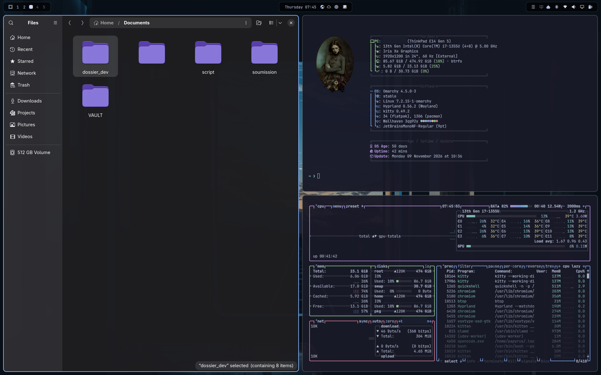
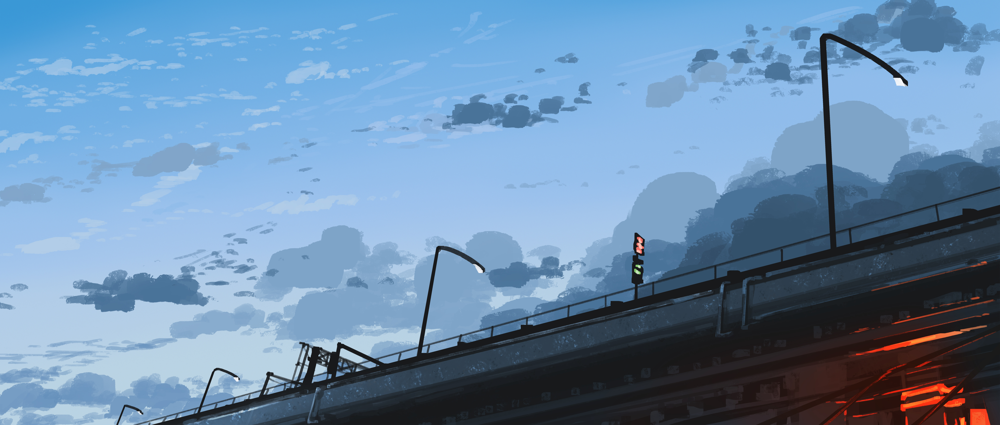
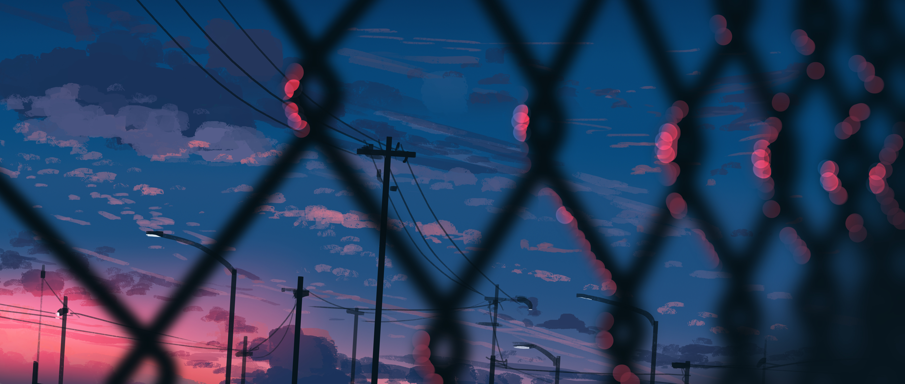

# Papyrus Islands

Un thème complet pour [Omarchy](https://omarchy.org/) 




## Fonds d'écran

Le fond d'origine est l'aperçu ci-dessus ; voici les deux variantes fournies
(à faire défiler avec `omarchy theme bg next`) :





## Installation 

```sh
curl -fsSL https://raw.githubusercontent.com/papyrus448/omarchy-papyrus-islands/main/install.sh | bash
```

Ou depuis un clone du dépôt :

```sh
git clone https://github.com/papyrus448/omarchy-papyrus-islands.git
cd omarchy-papyrus-islands
./install.sh
```

L'installateur sauvegarde chaque fichier qu'il remplace dans un
`<fichier>.bak.<date>` (et un éventuel thème existant dans
`~/.config/omarchy/themes-backup/`), puis applique le thème, redémarre le shell
et recharge Hyprland.

## Ce que ça installe

| Élément | Emplacement | Détail |
|---|---|---|
| Couleurs | `~/.config/omarchy/themes/papyrus-islands/colors.toml` | Palette Catppuccin Mocha, accent bleu `#89b4fa` |
| Fond d'écran | `…/papyrus-islands/backgrounds/` | Wallhaven `3qg92y` + 2 variantes (`wallpaper-2`, `wallpaper-3`) |
| Arrondis | `…/papyrus-islands/hyprland.lua` + bloc géré dans `~/.config/hypr/looknfeel.lua` | Arrondi 8 px, fenêtres inactives atténuées (0,15) |
| Console | `~/.config/fastfetch/config.jsonc` + `cli.png` | Le fastfetch complet (hardware, software, uptime) |
| Barre | `~/.config/omarchy/shell.json` | Barre `lobo.islands`, îlots noirs translucides, horloge centrée |
| Plugin barre | `~/.config/omarchy/plugins/lobo.islands/` | [Islands](https://github.com/DanielLob-o/Islands) (MIT), installé depuis sa source |

La disposition de la barre reprend le style de l'auteur avec les widgets
intégrés d'Omarchy : menu, workspaces, horloge, fuseaux horaires, météo, mises à
jour, clavier, tray, agents, Bluetooth, réseau, audio, moniteur et alimentation.

## Prérequis

- Omarchy 4.x (Quattro) avec Hyprland
- `git` et `jq`
- Une police Nerd Font pour fastfetch (Omarchy installe JetBrainsMono Nerd Font
  par défaut)

## Personnaliser

**Couleurs** — modifie `~/.config/omarchy/themes/papyrus-islands/colors.toml`,
puis réapplique :

```sh
omarchy theme set papyrus-islands
```

**Arrondis** — la valeur vit dans le bloc `papyrus-islands` à la fin de
`~/.config/hypr/looknfeel.lua` et dans le `hyprland.lua` du thème. Change les
deux puis :

```sh
hyprctl reload
```

**Îlots** — les réglages sont dans `bar.islands` de
`~/.config/omarchy/shell.json` (`color`, `opacity`, `radius`, `borderOpacity`,
`padding`). `radius: -1` suit l'arrondi des fenêtres.

**Fastfetch** — remplace `~/.config/fastfetch/cli.png` par ton propre logo. Le
type `auto` affiche l'image dans Kitty/Ghostty et retombe proprement ailleurs.

## Désinstallation

```sh
curl -fsSL https://raw.githubusercontent.com/papyrus448/omarchy-papyrus-islands/main/uninstall.sh | bash
```

Le désinstalleur est aussi conservé dans
`~/.local/share/omarchy-papyrus-islands/uninstall.sh`. Il restaure les
sauvegardes les plus récentes de `shell.json`, `fastfetch` et `looknfeel.lua`,
puis supprime le thème. Le plugin Islands reste installé, mais inutilisé :

```sh
omarchy plugin remove lobo.islands --yes
```

## Crédits

- [Omarchy](https://omarchy.org/) et son shell, par David Heinemeier Hansson
- [Catppuccin](https://catppuccin.com/) pour la palette Mocha
- [Islands](https://github.com/DanielLob-o/Islands) par Daniel Lobo (MIT)
- Fond d'écran : [Wallhaven 3qg92y](https://wallhaven.cc/w/3qg92y)
- Logo fastfetch : fourni par l'auteur du thème

## Licence

Le code et les fichiers de configuration de ce dépôt sont sous licence MIT
(voir [`LICENSE`](LICENSE)). Le fond d'écran et le logo fastfetch appartiennent à
leurs auteurs respectifs et ne sont pas couverts par cette licence.
