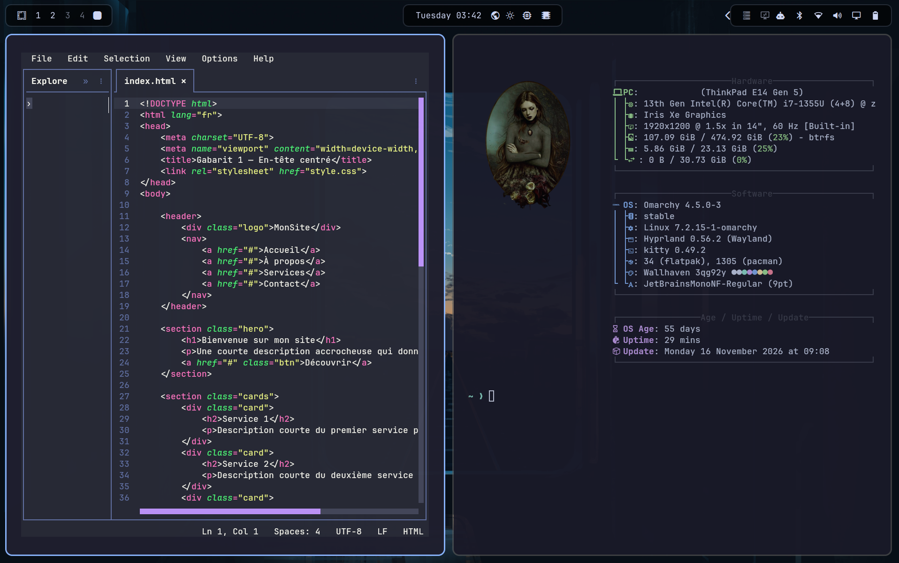
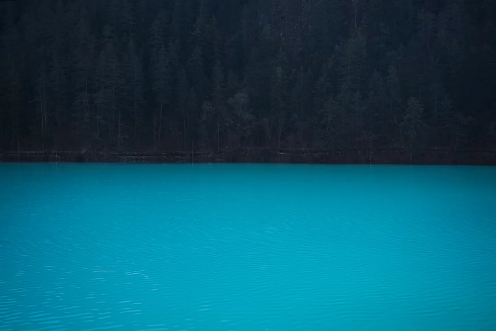
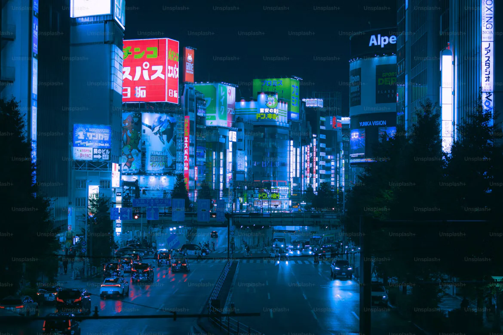

# Papyrus Islands

Un thème [Omarchy](https://omarchy.org/) : palette Catppuccin Mocha (accent bleu
`#89b4fa`).


*Aperçu original généré depuis `colors.toml` : aucune image tierce n'est utilisée.*



*Capture de la session (barre en îlots et console), fournie par l'auteur du thème.*

## Installation

```sh
omarchy theme install https://github.com/papyrus448/omarchy-papyrus-islands
```

Le dépôt fournit la palette (`colors.toml`), cet aperçu et deux fonds d'écran
libres de droits dans `backgrounds/`. Omarchy les installe automatiquement.

```sh
omarchy theme bg next        # fond suivant
omarchy theme bg set ~/Pictures/1.avif   # ou un fond précis
```

## Fonds d'écran inclus (libres de droits)

Deux fonds fournis par l'auteur du thème, **libres de droits**. Les versions
WebP sont celles qu'Omarchy utilise ; les originaux AVIF sont conservés dans
`assets/`.



[Original AVIF 1](assets/1.avif) · [Original AVIF 2](assets/2.avif)



## Autres fonds (liens uniquement)

Ces images ne sont **pas** incluses dans le dépôt : leurs droits appartiennent
à leurs auteurs.

| Fond | Lien |
|---|---|
| Principal (3qg92y) | [Wallhaven 3qg92y](https://wallhaven.cc/w/3qg92y) |
| Variante 2 (e8ry7l) | [Wallhaven e8ry7l](https://wallhaven.cc/w/e8ry7l) |
| Variante 3 (xewlkl) | [Wallhaven xewlkl](https://wallhaven.cc/w/xewlkl) |

## Crédits

- Fonds `1` et `2` : fournis par l'auteur du thème, libres de droits.
- Capture d'écran : fournie par l'auteur du thème.
- Les trois fonds Wallhaven sont des créations de **Gracile**
  ([Pixiv, utilisateur 3434849](https://www.pixiv.net/en/users/3434849)),
  telles que référencées sur Wallhaven. Elles restent la propriété de leur
  auteur ; le dépôt ne fait que renvoyer vers les pages d'origine.
  - `3qg92y` et `xewlkl` : uploadés sur Wallhaven par **Artix**
  - `e8ry7l` : uploadé sur Wallhaven par **jrmnt**
- [Wallhaven](https://wallhaven.cc/) : « All images remain property of their original owners. »
- [Omarchy](https://omarchy.org/) et son shell, par David Heinemeier Hansson
- [Catppuccin](https://catppuccin.com/) pour la palette Mocha

## Extras

La configuration fastfetch, la barre en îlots et les arrondis de la machine de
l'auteur sont dans un dépôt séparé :
[omarchy-papyrus-islands-extras](https://github.com/papyrus448/omarchy-papyrus-islands-extras).

## Licence

`colors.toml`, `preview.png`, `screenshot.png`, les fichiers de configuration et
les deux fonds libres de droits (`backgrounds/1.webp`, `backgrounds/2.webp` et
leurs originaux dans `assets/`) sont couverts par la licence MIT (voir
[`LICENSE`](LICENSE)).
Les images Wallhaven ne sont pas incluses dans ce dépôt.
