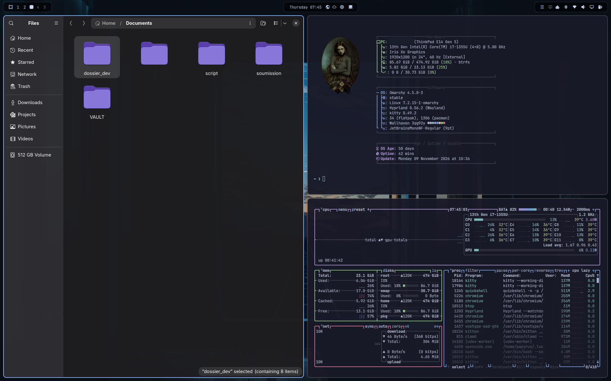
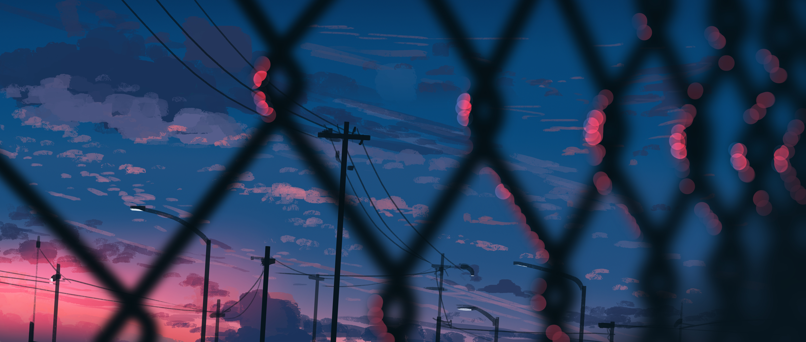

# Papyrus Islands

Un thème [Omarchy](https://omarchy.org/) : palette Catppuccin Mocha (accent bleu
`#89b4fa`) et trois fonds d'écran.




## Fonds d'écran




## Installation

```sh
omarchy theme install https://github.com/papyrus448/omarchy-papyrus-islands
```

Omarchy clone le dépôt dans `~/.config/omarchy/themes/papyrus-islands`, n'installe
que les fichiers de thème (`colors.toml`, `backgrounds/`, `preview.jpg`) et
applique le thème immédiatement.

- Fond suivant : `omarchy theme bg next`
- Mise à jour : `omarchy theme update`
- Retrait : `omarchy theme remove papyrus-islands`

## Extras

La configuration fastfetch, la barre en îlots et les arrondis de la machine de
l'auteur ne font pas partie du thème : ils sont dans un dépôt séparé,
[omarchy-papyrus-islands-extras](https://github.com/papyrus448/omarchy-papyrus-islands-extras).
Son installateur est optionnel et ne s'applique qu'à la demande.

## Crédits

- [Omarchy](https://omarchy.org/) et son shell, par David Heinemeier Hansson
- [Catppuccin](https://catppuccin.com/) pour la palette Mocha
- Fond d'écran : [Wallhaven 3qg92y](https://wallhaven.cc/w/3qg92y)

## Licence

Les fichiers de configuration de ce dépôt sont sous licence MIT (voir
[`LICENSE`](LICENSE)). Les images (fonds d'écran, aperçu, capture, logo) ne sont
pas couvertes par cette licence.
