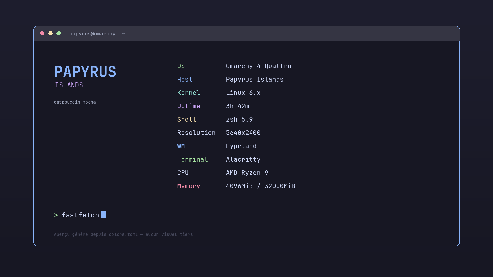

# Papyrus Islands

Un thème [Omarchy](https://omarchy.org/) : palette Catppuccin Mocha (accent bleu
`#89b4fa`).



*Aperçu original généré depuis `colors.toml` : aucune image tierce n'est utilisée.*

## Installation

```sh
omarchy theme install https://github.com/papyrus448/omarchy-papyrus-islands
```

Ce dépôt contient la palette (`colors.toml`) et l'aperçu ci-dessus. Les fonds
d'écran ne sont pas redistribués : télécharge-les depuis les liens ci-dessous,
puis applique celui que tu veux avec :

```sh
omarchy theme bg set ~/Pictures/wallhaven-3qg92y.jpg
```

## Fonds d'écran (liens uniquement)

Les fonds ne sont pas inclus dans le dépôt pour des raisons de droits d'auteur.

| Fond | Lien |
|---|---|
| Principal (3qg92y) | [Wallhaven 3qg92y](https://wallhaven.cc/w/3qg92y) |
| Variante 2 (e8ry7l) | [Wallhaven e8ry7l](https://wallhaven.cc/w/e8ry7l) |
| Variante 3 (xewlkl) | [Wallhaven xewlkl](https://wallhaven.cc/w/xewlkl) |

## Crédits

Les trois images sont des créations de **Gracile**
([Pixiv, utilisateur 3434849](https://www.pixiv.net/en/users/3434849)),
telles que référencées sur Wallhaven. Elles restent la propriété de leur
auteur ; le dépôt ne fait que renvoyer vers les pages d'origine.

- `3qg92y` et `xewlkl` : uploadés sur Wallhaven par **Artix**
- `e8ry7l` : uploadé sur Wallhaven par **jrmnt**
- [Wallhaven](https://wallhaven.cc/) : « All images remain property of their original owners. »
- [Omarchy](https://omarchy.org/) et son shell, par David Heinemeier Hansson
- [Catppuccin](https://catppuccin.com/) pour la palette Mocha

## Extras

La configuration fastfetch, la barre en îlots et les arrondis de la machine de
l'auteur sont dans un dépôt séparé :
[omarchy-papyrus-islands-extras](https://github.com/papyrus448/omarchy-papyrus-islands-extras).

## Licence

`colors.toml`, `preview.png` et les fichiers de configuration sont sous licence
MIT (voir [`LICENSE`](LICENSE)). L'aperçu est généré à partir de la palette ;
aucune image tierce n'est incluse dans ce dépôt.
